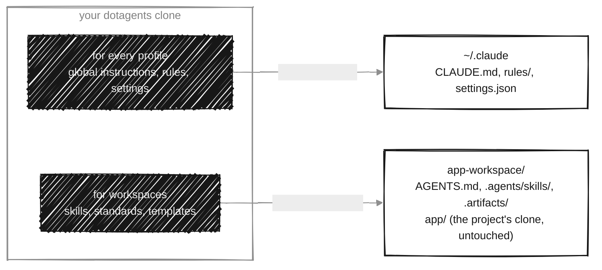
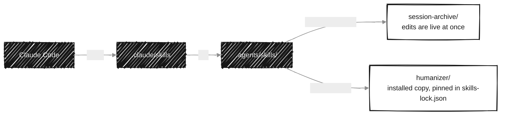
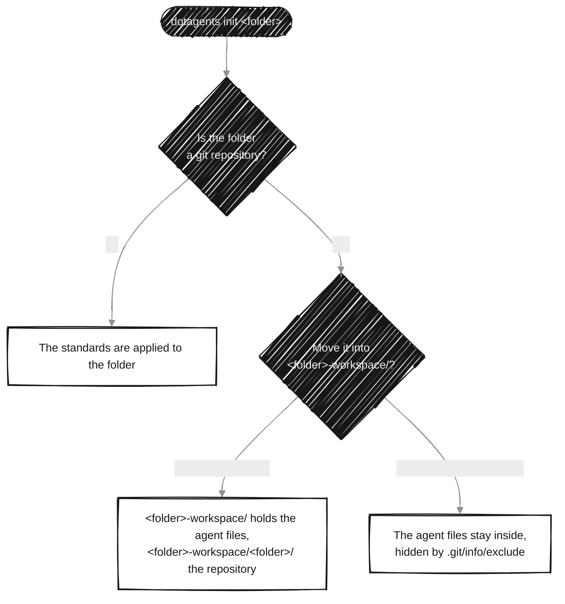
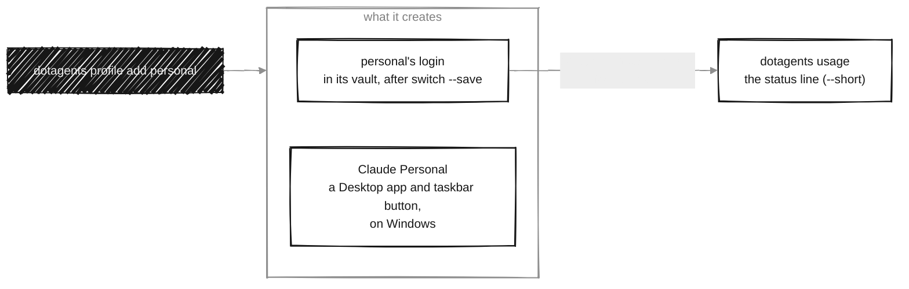
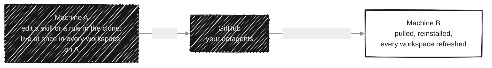

<p align="center">
  <picture>
    <source media="(prefers-color-scheme: dark)" srcset="assets/dotagents-lockup-dark.svg">
    
  </picture>
</p>

<p align="center"><b>One Claude Code configuration, on every machine and in every project.</b></p>

<p align="center">
  <a href="#features">Features</a>&nbsp;&nbsp;&nbsp;
  <a href="#how-it-works">How it works</a>&nbsp;&nbsp;&nbsp;
  <a href="#quick-start">Quick start</a>&nbsp;&nbsp;&nbsp;
  <a href="#commands-at-a-glance">Commands</a>&nbsp;&nbsp;&nbsp;
  <a href="docs/README.md">Documentation</a>&nbsp;&nbsp;&nbsp;
  <a href="CHANGELOG.md">Changelog</a>
</p>

<p align="center">
  
  
  
</p>

<p align="center">
  <picture>
    <source media="(prefers-color-scheme: dark)" srcset="docs/media/usage-dark.svg">
    
  </picture>
</p>

Claude Code reads its configuration from `~/.claude/` on each machine and from `.claude/`, `CLAUDE.md` or `AGENTS.md` in each project. Use it across a few projects and two machines, and the copies drift apart: the same skill copied into several projects, an instruction fixed on one machine and forgotten on the other, project files leaking into the repository's git.

dotagents keeps all of it in one git repository, yours, and a single command writes or links what Claude Code expects. You never edit `~/.claude/` or a workspace's `.claude/` by hand again.

## Features

- **One source of truth.** Global instructions, rules, settings and skills are written once and reach every machine and workspace.
- **Machine setup in one command.** `dotagents install` writes the global configuration where Claude Code looks for it, on Windows, Linux (WSL included) and macOS.
- **Workspaces that keep projects clean.** A project gets its `AGENTS.md`, skills and documentation in a folder that wraps its repositories, so not a single agent file lands in the project's git history, not even a `.gitignore` rule.
- **Skills, yours and other people's.** Your own skills are linked, so an edit is live everywhere at once; third-party ones come from a catalog and install through [`npx skills`](https://skills.sh).
- **A checklist you can run.** `dotagents check` verifies a workspace against the standards and exits non-zero when something is off.
- **Safe to run again.** Every action is idempotent and has a `--dry-run`; files you wrote are never overwritten without a backup.

## How it works

Your dotagents repository is the source. `install` applies it to every Claude profile on the machine; `new` and `init` apply it to a workspace.



### Inside a workspace

Claude Code reads the skills through `.claude/skills`. Your own skills are links back to the clone; third-party ones are installed copies, pinned in `skills-lock.json`.



### Keeping the project's git clean

The agent files live next to the repositories, never inside them. `new` clones straight into that layout, and `init` offers to move a repository that is already on disk:



### Several profiles, one view

A profile is one claude.ai account. Every profile uses `~/.claude`, so the history and the configuration are shared; `switch` puts a profile's login there, and `usage` shows what each one has used, from Claude Code's own cache or asked of Anthropic.



### Two machines, one setup

The command runs from your clone, so an edit there is live at once on that machine. The other machine catches up with one command.



## Quick start

You need Node.js 22.18+ and git. Fork or copy this repository to your own GitHub account, then, once per machine:

```bash
git clone git@github.com:<you>/dotagents.git
cd dotagents
npm install && npm link    # the `dotagents` command, pointing to this clone
dotagents install          # global instructions, rules and settings
```

Then set up a project:

```bash
cd ~/projects
dotagents new git@github.com:me/app.git    # app-workspace/ with app/ inside; asks which skills to use
cd app-workspace                           # run Claude Code here
```

The result:

```
app-workspace/
├── AGENTS.md             project instructions, read by Claude Code
├── .agents/skills/       the skills this project uses
├── .claude/              links to .agents/, plus settings.json
├── .artifacts/           plans, session transcripts, docs written by agents and people
└── app/                  the git clone: only the project's own files
```

More in [Getting started](docs/getting-started.md), including WSL and npm without `sudo`. What changed in each version is in the [CHANGELOG](CHANGELOG.md).

## Commands at a glance

| Command | What it does |
|---|---|
| [`install`](docs/commands.md#dotagents-install) | Applies the global configuration to this machine. |
| [`update [--all]`](docs/commands.md#dotagents-update) | Pulls your repository and reinstalls; `--all` also refreshes every workspace. |
| [`settings pull`](docs/commands.md#dotagents-settings-pull) | Brings a settings change made with `/config` (the Windows copy) back into the repository. |
| [`profile add <name>`](docs/commands.md#dotagents-profile-add) · [`profile list`](docs/commands.md#dotagents-profile-list) · [`profile remove`](docs/commands.md#dotagents-profile-remove) | One profile per claude.ai account, all in `~/.claude`; on Windows, a Desktop app each. |
| [`switch <profile>`](docs/commands.md#dotagents-switch) | Puts a profile's login in `~/.claude` on both sides, keeping each account's login in a vault. |
| [`usage`](docs/commands.md#dotagents-usage) | How much of each profile's plan is used, from Claude Code's cache or, with `--refresh`, asked of Anthropic. |
| [`start`](docs/commands.md#dotagents-start) | Starts the dashboard's local server: the usage of every profile, live, in a page on 127.0.0.1. |
| [`new <git-url> [folder]`](docs/commands.md#dotagents-new) | Creates a workspace, clones the repository into it and applies the standards. |
| [`init [path]`](docs/commands.md#dotagents-init) | Applies the standards to a folder, offering to wrap a repository first. |
| [`check [path]`](docs/commands.md#dotagents-check) | Runs the checklist on a workspace, changing nothing. |
| [`workspaces`](docs/commands.md#dotagents-workspaces) · [`untrack <path>`](docs/commands.md#dotagents-untrack) | Lists the tracked workspaces; stops tracking one. |
| [`skills`](docs/commands.md#dotagents-skills) · [`skills add`](docs/commands.md#dotagents-skills-add) · [`skills remove`](docs/commands.md#dotagents-skills-remove) | Lists, registers and unregisters skills. |

Every command that changes something takes `--dry-run`.

## Documentation

- [Getting started](docs/getting-started.md): requirements, installation, the first workspace.
- [Commands](docs/commands.md): every command and option, output, exit codes.
- [Workspaces](docs/workspaces.md): the layout, what `init` creates, what `check` verifies.
- [Skills](docs/skills.md): own and third-party skills, writing one.
- [Global configuration](docs/global-configuration.md): what `install` writes, and where.
- [Recipes](docs/recipes.md): common tasks, start to finish.
- [Architecture and development](docs/architecture.md): modules, tests, CI.
- [Troubleshooting and limits](docs/troubleshooting.md).
- Use case: [an Obsidian vault](docs/use-cases/obsidian-vault.md), synced by a cloud drive or by git.
- Standards: [`.agents/`](standards/agents.md) and [`.artifacts/`](standards/artifacts.md), based on Galster et al., *Configuring agentic AI coding tools: an exploratory study* (AIware '26).

## License

Private repository, all rights reserved (`UNLICENSED`). Third-party skills keep their own licenses.
