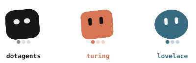
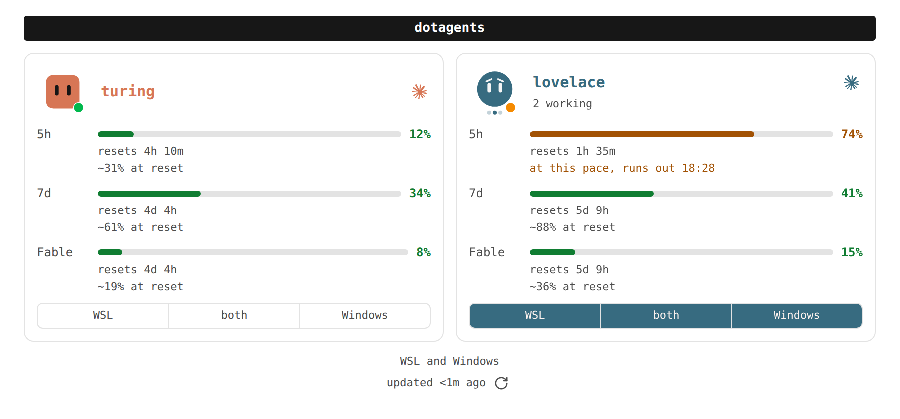
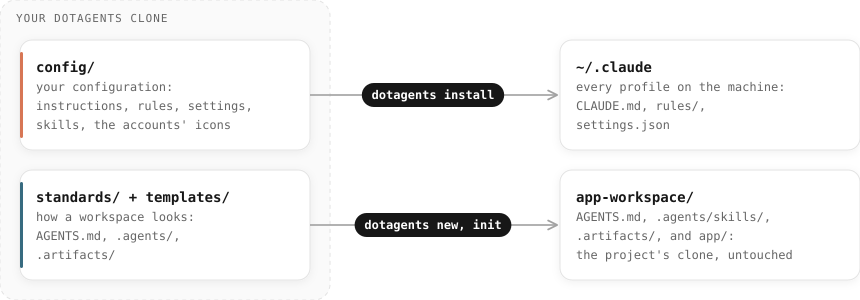
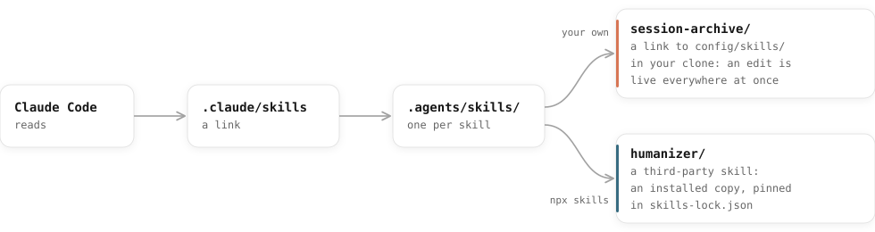
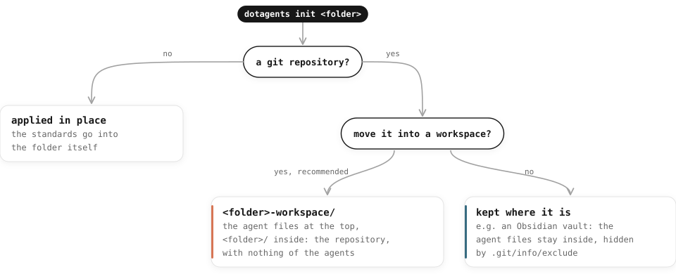
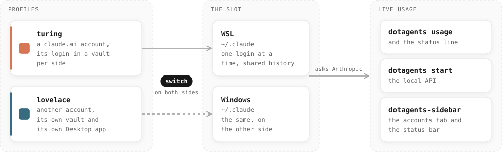
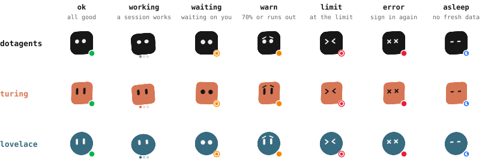
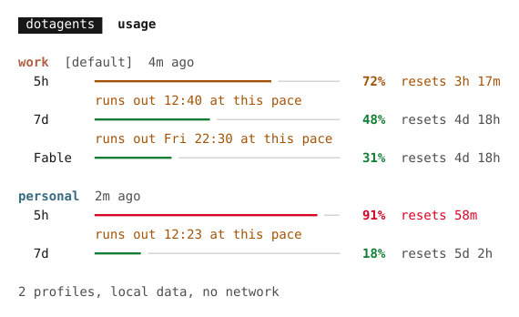
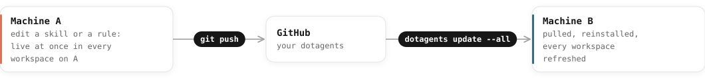

<p align="center">
  <picture>
    <source media="(prefers-color-scheme: dark)" srcset="assets/dotagents-lockup-dark.svg">
    
  </picture>
</p>

<p align="center"><b>One Claude Code configuration, on every machine and in every project.<br>Every Claude account you hold, switched in place and watched live.</b></p>

<p align="center">
  <a href="#features">Features</a>&nbsp;&nbsp;&nbsp;
  <a href="#how-it-works">How it works</a>&nbsp;&nbsp;&nbsp;
  <a href="#quick-start">Quick start</a>&nbsp;&nbsp;&nbsp;
  <a href="#commands-at-a-glance">Commands</a>&nbsp;&nbsp;&nbsp;
  <a href="docs/README.md">Documentation</a>&nbsp;&nbsp;&nbsp;
  <a href="CHANGELOG.md">Changelog</a>
</p>

<p align="center">
  
  
  
  
</p>

<p align="center">
  <picture>
    <source media="(prefers-color-scheme: dark)" srcset="assets/readme/avatars-dark.svg">
    
  </picture>
</p>

> [!NOTE]
> **This is my personal configuration project.** Many things here are shaped to the way I work: the global instructions, the rules, the skills, the two accounts (`turing` and `lovelace`), Windows with WSL. Everything that is mine lives in [`config/`](config/); the rest is the tool. If it is useful to you, feel free to use it, fork it, give feedback, contribute, and set it up your own way.

Claude Code reads its configuration from `~/.claude/` on each machine and from `.claude/`, `CLAUDE.md` or `AGENTS.md` in each project. Use it across a few projects and two machines, and the copies drift apart: the same skill copied into several projects, an instruction fixed on one machine and forgotten on the other, project files leaking into the repository's git. Hold more than one Claude seat and it gets worse: one login per machine at a time, and no single place that says how much of each plan is left.

dotagents keeps all of it in one git repository, yours, and a single command writes or links what Claude Code expects. You never edit `~/.claude/` or a workspace's `.claude/` by hand again. And for several accounts, it switches the login in place, shows each account's usage live, and opens one Claude Desktop per account, in the terminal, in a panel and in VS Code.

<p align="center">
  <picture>
    <source media="(prefers-color-scheme: dark)" srcset="assets/readme/panel-dark.png">
    
  </picture>
</p>

## Features

**Configuration**

- **One source of truth.** Global instructions, rules, settings and skills are written once, in `config/`, and reach every machine and workspace.
- **Machine setup in one command.** `dotagents install` writes the global configuration where Claude Code looks for it, on Windows, Linux (WSL included) and macOS.
- **Your configuration, wherever you keep it.** `config/` in your fork, or any folder of your own through `DOTAGENTS_CONFIG`, such as a private repository.

**Workspaces**

- **Projects stay clean.** A project gets its `AGENTS.md`, skills and documentation in a folder that wraps its repositories, so not a single agent file lands in the project's git history, not even a `.gitignore` rule.
- **Skills, yours and other people's.** Your own skills are linked, so an edit is live everywhere at once; third-party ones come from a catalog and install through [`npx skills`](https://skills.sh).
- **A checklist you can run.** `dotagents check` verifies a workspace against the standards and exits non-zero when something is off.

**Several Claude accounts**

- **Switch in place.** `dotagents switch` puts an account's login in `~/.claude`, on one side of the machine or both, keeping each login in a vault readable only by you. History and configuration stay shared.
- **Usage, live.** How much of each plan's 5-hour, weekly and per-model windows is used, with a projection to the reset ("at this pace, runs out 16:40"), from Claude Code's cache or asked of Anthropic.
- **A panel and VS Code.** `dotagents start` serves the panel on 127.0.0.1; the VS Code extension shows the current account in the status bar and the panel in the side bar. Each account has an avatar that says how it is at a glance.
- **One Desktop app per account** on Windows, each with its own icon and taskbar button, open side by side.

**Everywhere**

- **Safe to run again.** Every action is idempotent and has a `--dry-run`; files you wrote are never overwritten without a backup.

## How it works

Your dotagents clone is the source. `install` applies `config/` to every Claude profile on the machine; `new` and `init` apply the standards to a workspace.

<p align="center">
  <picture>
    <source media="(prefers-color-scheme: dark)" srcset="assets/readme/how-it-works-dark.svg">
    
  </picture>
</p>

### Inside a workspace

Claude Code reads the skills through `.claude/skills`. Your own skills are links back to `config/skills/` in the clone; third-party ones are installed copies, pinned in `skills-lock.json`.

<p align="center">
  <picture>
    <source media="(prefers-color-scheme: dark)" srcset="assets/readme/workspace-skills-dark.svg">
    
  </picture>
</p>

### Keeping the project's git clean

The agent files live next to the repositories, never inside them. `new` clones straight into that layout, and `init` offers to move a repository that is already on disk:

<p align="center">
  <picture>
    <source media="(prefers-color-scheme: dark)" srcset="assets/readme/git-clean-dark.svg">
    
  </picture>
</p>

### Several accounts, one view

A profile is one claude.ai account. Every profile uses `~/.claude`, so the history and the configuration are shared; `switch` puts a profile's login there, on one side of the machine or both, and its login waits in a vault while another is in use. `usage`, the panel and the VS Code extension show what each one has used, from Claude Code's own cache or asked of Anthropic. On Windows, each profile also gets its own Claude Desktop app.

<p align="center">
  <picture>
    <source media="(prefers-color-scheme: dark)" srcset="assets/readme/accounts-dark.svg">
    
  </picture>
</p>

Each account has an avatar, in its color and shape. Its eyes and the dot in the corner say how it is; a session at work makes it hop.

<p align="center">
  <picture>
    <source media="(prefers-color-scheme: dark)" srcset="assets/readme/states-dark.svg">
    
  </picture>
</p>

In the terminal, the same numbers:

<p align="center">
  <picture>
    <source media="(prefers-color-scheme: dark)" srcset="docs/media/usage-dark.svg">
    
  </picture>
</p>

### Two machines, one setup

The command runs from your clone, so an edit there is live at once on that machine. The other machine catches up with one command.

<p align="center">
  <picture>
    <source media="(prefers-color-scheme: dark)" srcset="assets/readme/two-machines-dark.svg">
    
  </picture>
</p>

## Quick start

You need Node.js 22.18+ and git. Fork this repository (or copy it to your own GitHub account), make `config/` yours (start with `config/global/instructions.md` and `config/global/env/`), then, once per machine:

```bash
git clone git@github.com:<you>/dotagents.git
cd dotagents
npm install && npm link # the `dotagents` command, pointing to this clone
dotagents install # global instructions, rules and settings
```

Then set up a project:

```bash
cd ~/projects
dotagents new git@github.com:me/app.git # app-workspace/ with app/ inside; asks which skills to use
cd app-workspace # run Claude Code here
```

The result:

```
app-workspace/
├── AGENTS.md             project instructions, read by Claude Code
├── .agents/skills/       the skills this project uses
├── .claude/              links to .agents/, plus settings.json
├── .artifacts/           plans, session transcripts, docs written by agents and people
└── app/                  the git clone: only the project's own files
```

With more than one Claude account:

```bash
dotagents profile add work # one profile per claude.ai account
dotagents switch work # its login in ~/.claude, on both sides; --here for this side only
dotagents usage --refresh # every account's usage, asked of Anthropic
dotagents start # the panel, live, on 127.0.0.1
```

The VS Code extension is built from [`surfaces/vscode/`](surfaces/vscode/) with `npm run package`, or installed from a [release](https://github.com/gabrieldulolmarques/dotagents/releases).

More in [Getting started](docs/getting-started.md), including WSL and npm without `sudo`. What changed in each version is in the [CHANGELOG](CHANGELOG.md).

### Keeping your configuration elsewhere

The tool reads `config/` from the clone. To keep your configuration in a repository of its own, private or not, give it the same layout and point `DOTAGENTS_CONFIG` at it:

```
my-config/
├── global/       instructions.md, env/<platform>.md
├── rules/        rules for every project
├── claude/       settings.json, global-config.json
├── skills/       your skills, and third-party-skills.json
└── assets/       claude-<profile>.svg and .ico, each profile's Desktop icon
```

## Commands at a glance

| Command | What it does |
|---|---|
| [`install`](docs/commands.md#dotagents-install) | Applies the global configuration to this machine. |
| [`update [--all]`](docs/commands.md#dotagents-update) | Pulls your repository and reinstalls; `--all` also refreshes every workspace. |
| [`settings pull`](docs/commands.md#dotagents-settings-pull) | Brings a settings change made with `/config` (the Windows copy) back into the repository. |
| [`profile add <name>`](docs/commands.md#dotagents-profile-add), [`profile list`](docs/commands.md#dotagents-profile-list), [`profile remove`](docs/commands.md#dotagents-profile-remove) | One profile per claude.ai account, all in `~/.claude`; on Windows, a Desktop app each. |
| [`switch <profile>`](docs/commands.md#dotagents-switch) | Puts a profile's login in `~/.claude` on both sides (`--here` for one), keeping each account's login in a vault. |
| [`login <profile>`](docs/commands.md#dotagents-login) | Signs a profile in again on this side when its login runs out, then puts the previous account back; `--all` for every login running out. |
| [`usage`](docs/commands.md#dotagents-usage) | How much of each profile's plan is used, with a projection to the reset, from Claude Code's cache or, with `--refresh`, asked of Anthropic. |
| [`start`](docs/commands.md#dotagents-start) | Serves the panel on 127.0.0.1: every account live, the switch for one side or both, its Desktop app. The [VS Code extension](docs/commands.md#the-vs-code-extension) uses it. |
| [`new <git-url> [folder]`](docs/commands.md#dotagents-new) | Creates a workspace, clones the repository into it and applies the standards. |
| [`init [path]`](docs/commands.md#dotagents-init) | Applies the standards to a folder, offering to wrap a repository first. |
| [`check [path]`](docs/commands.md#dotagents-check) | Runs the checklist on a workspace, changing nothing. |
| [`workspaces`](docs/commands.md#dotagents-workspaces), [`untrack <path>`](docs/commands.md#dotagents-untrack) | Lists the tracked workspaces; stops tracking one. |
| [`sessions`](docs/commands.md#dotagents-sessions), [`sessions rm`](docs/commands.md#dotagents-sessions-rm) | Lists Claude Code's sessions on both sides, with the account of each; deletes them after archiving them into `.artifacts/session-archives/`. |
| [`skills`](docs/commands.md#dotagents-skills), [`skills add`](docs/commands.md#dotagents-skills-add), [`skills remove`](docs/commands.md#dotagents-skills-remove) | Lists, registers and unregisters skills. |

Every command that changes something takes `--dry-run`.

## Documentation

- [Getting started](docs/getting-started.md): requirements, installation, the first workspace.
- [Commands](docs/commands.md): every command and option, output, exit codes; the panel and the VS Code extension.
- [Workspaces](docs/workspaces.md): the layout, what `init` creates, what `check` verifies.
- [Skills](docs/skills.md): own and third-party skills, writing one.
- [Global configuration](docs/global-configuration.md): what `install` writes, and where; `config/` and `DOTAGENTS_CONFIG`.
- [Recipes](docs/recipes.md): common tasks, start to finish.
- [Architecture and development](docs/architecture.md): modules, tests, CI.
- [Troubleshooting and limits](docs/troubleshooting.md).
- Use case: [an Obsidian vault](docs/use-cases/obsidian-vault.md), synced by a cloud drive or by git.
- Standards: [`.agents/`](standards/agents.md) and [`.artifacts/`](standards/artifacts.md), based on Galster et al., *Configuring agentic AI coding tools: an exploratory study* (AIware '26).

## Contributing

Issues and pull requests are welcome: a bug, an idea, a skill worth sharing, a better default. Keep in mind that dotagents follows one person's way of working, so a change that fits everyone goes in the tool, and one that fits your way goes in your own `config/`. Before a pull request, run `npm test` (the type check and the unit tests); commits follow [the commit convention](config/rules/commit-conventions.md).

## License

[MIT](LICENSE). Third-party skills keep their own licenses.
