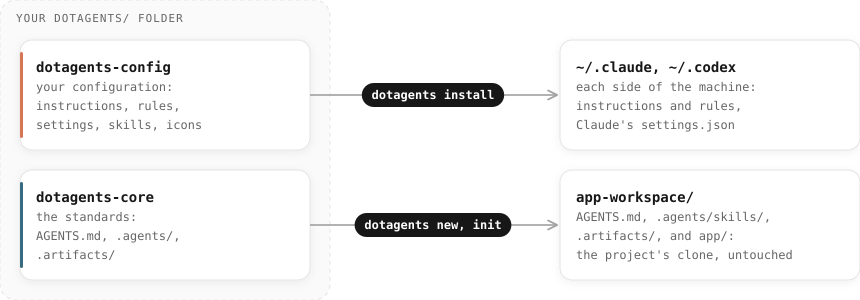
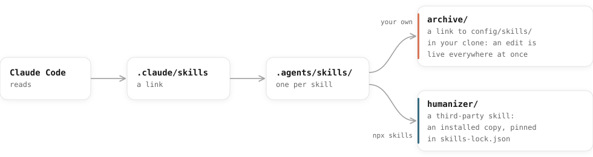
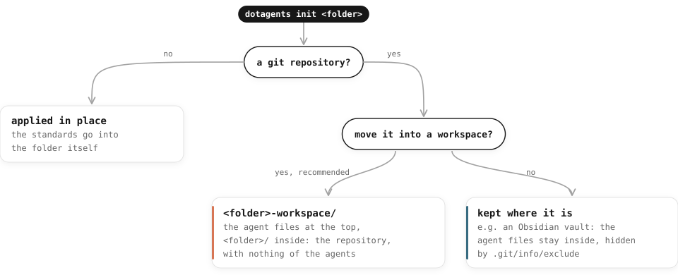
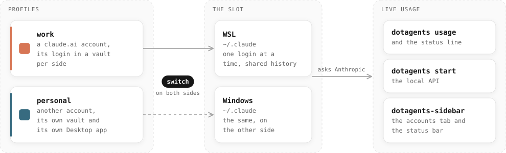
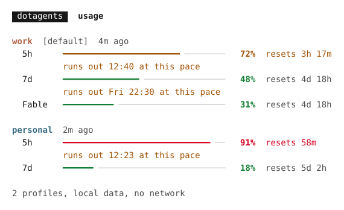
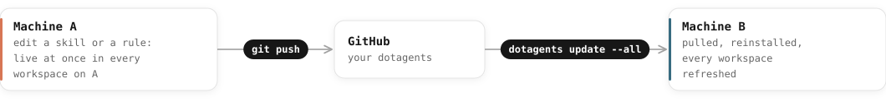

<p align="center">
  <picture>
    <source media="(prefers-color-scheme: dark)" srcset="assets/dotagents-core-lockup-dark.svg">
    
  </picture>
</p>

<p align="center"><b>Shared configuration for Claude Code and Codex.<br>Your Claude and ChatGPT accounts, switched in place and watched live.</b></p>

<p align="center">
  <a href="#features">Features</a>&nbsp;&nbsp;&nbsp;
  <a href="#how-it-works">How it works</a>&nbsp;&nbsp;&nbsp;
  <a href="#quick-start">Quick start</a>&nbsp;&nbsp;&nbsp;
  <a href="#commands-at-a-glance">Commands</a>&nbsp;&nbsp;&nbsp;
  <a href="docs/README.md">Documentation</a>&nbsp;&nbsp;&nbsp;
  <a href="CHANGELOG.md">Changelog</a>
</p>

<p align="center">
  
  
  
  
  
</p>

Claude Code reads its configuration from `~/.claude/` on each machine and from `.claude/`, `CLAUDE.md` or `AGENTS.md` in each project. Use it across a few projects and two machines, and the copies drift apart: the same skill copied into several projects, an instruction fixed on one machine and forgotten on the other, project files leaking into the repository's git. Hold more than one Claude seat and it gets worse: one login per machine at a time, and no single place that says how much of each plan is left.

dotagents keeps the configuration in your git repository and applies shared instructions, rules and workspace skills to Claude Code and Codex. It switches Claude and ChatGPT logins in place and shows each account's usage in the terminal and in the [dotagents sidebar](https://github.com/dotagents-org/dotagents-sidebar).

> [!TIP]
> **Strongly recommended: the [dotagents sidebar](https://github.com/dotagents-org/dotagents-sidebar) in VS Code.** dotagents also works from the terminal. The sidebar brings Claude Code and Codex to VS Code's secondary sidebar, in sessions that survive a reload, with your accounts beside it, their usage and state at a glance, the current one in the status bar and the switch a click away.

## Features

**Configuration**

- **One source of truth.** Global instructions, rules, settings and skills are written once, in your configuration, and reach every machine and workspace.
- **Machine setup in one command.** `dotagents install` writes the global configuration where Claude Code and Codex look for it, on Windows, Linux (WSL included) and macOS.
- **Your configuration, in a repository of its own.** `dotagents-config` next to the clone, `config/` inside a fork, or any folder through `DOTAGENTS_CONFIG`.

**Workspaces**

- **Projects stay clean.** A project gets its `AGENTS.md`, skills and documentation in a folder that wraps its repositories, so not a single agent file lands in the project's git history, not even a `.gitignore` rule.
- **Skills, yours and other people's.** Your own skills are linked, so an edit is live everywhere at once; third-party ones come from a catalog and install through [`npx skills`](https://skills.sh).
- **A checklist you can run.** `dotagents check` verifies a workspace against the standards and exits non-zero when something is off.
- **Sessions of both agents.** `dotagents sessions` lists Claude Code's and Codex's conversations on both sides of the machine, with the account of each; `sessions rm` deletes them, and the `archive` skill, run from inside a session, writes one to `.artifacts/sessions/`.

**Claude and ChatGPT accounts**

- **Switch in place.** `dotagents switch` puts an account's login in its agent's slot (`~/.claude` for Claude Code, `~/.codex/auth.json` for Codex), on one side of the machine or both, keeping each login in a private vault. History and configuration stay shared.
- **Usage, live.** Both providers show 5-hour and weekly windows with projections, from either side of the machine, whichever read the account last. Claude also shows per-model windows when available and combines Claude Code's cache with readings from Anthropic. ChatGPT usage comes through the Codex app-server.
- **What 1% costs.** `usage --spend` relates each window's % to the tokens your sessions spent, from Claude Code's transcripts and Codex's rollouts: in dollars at the API's prices for Claude, in tokens for ChatGPT, by model and by folder.
- **Logins kept alive.** `login --all` signs in again every Claude login about to run out and every ChatGPT login refused or not saved yet; `doctor` checks Node, Claude Code and Codex, and every login, on both sides.
- **In VS Code, with the dotagents sidebar (strongly recommended).** `dotagents start` is a local API on 127.0.0.1; the [dotagents sidebar](https://github.com/dotagents-org/dotagents-sidebar) reads it to show every account, with an avatar that says how it is at a glance, the current one in the status bar, and the switch.
- **A Desktop launcher per profile** on Windows, for Claude Desktop and the ChatGPT app, with a profile icon and taskbar button.

**Everywhere**

- **Safe to run again.** Every action is idempotent and has a `--dry-run`; files you wrote are never overwritten without a backup.

## How it works

Your configuration is the source. `install` applies it to the agent slots on the machine; `new` and `init` apply the standards to a workspace.

<p align="center">
  <picture>
    <source media="(prefers-color-scheme: dark)" srcset="assets/readme/how-it-works-dark.svg">
    
  </picture>
</p>

### Inside a workspace

Codex reads `.agents/skills`, and Claude Code reaches the same directory through `.claude/skills`. Own skills are linked from the tool or configuration. Third-party skills are installed copies pinned in `skills-lock.json`. Each skill determines which agent it can work with.

<p align="center">
  <picture>
    <source media="(prefers-color-scheme: dark)" srcset="assets/readme/workspace-skills-dark.svg">
    
  </picture>
</p>

### Keeping the project's git clean

The agent files live next to the repositories, never inside them. `new` clones straight into that layout, and `init` offers to move a repository that is already on disk:

<p align="center">
  <picture>
    <source media="(prefers-color-scheme: dark)" srcset="assets/readme/git-clean-dark.svg">
    
  </picture>
</p>

### Several accounts, one view

A profile is one Claude account, for Claude Code, or one ChatGPT account, for Codex. Every Claude profile uses `~/.claude` and every ChatGPT one `~/.codex`, so the history and the configuration are shared; `switch` puts a profile's login there, on one side of the machine or both, and its login waits in a vault while another is in use. `usage` and the dotagents sidebar show what each one has used, asked of Anthropic or OpenAI. On Windows, each profile also gets its own Desktop app: Claude Desktop for a Claude profile, the ChatGPT app for a ChatGPT one.

One account is enough: everything else works the same with a single profile, and a second one is your choice. More than one is for a person who holds several seats in their own name, under each provider's terms; see [Several accounts and the providers' terms](docs/security.md#several-accounts-and-the-providers-terms).

<p align="center">
  <picture>
    <source media="(prefers-color-scheme: dark)" srcset="assets/readme/accounts-dark.svg">
    
  </picture>
</p>

In VS Code, each account has an avatar, in its color and shape, whose eyes and corner dot say how it is: that is the [dotagents sidebar](https://github.com/dotagents-org/dotagents-sidebar#the-accounts).

In the terminal, the same numbers:

<p align="center">
  <picture>
    <source media="(prefers-color-scheme: dark)" srcset="docs/media/usage-dark.svg">
    
  </picture>
</p>

### Two machines, one setup

The command runs from your clone, so an edit there is live at once on that machine. The other machine catches up with one command.

<p align="center">
  <picture>
    <source media="(prefers-color-scheme: dark)" srcset="assets/readme/two-machines-dark.svg">
    
  </picture>
</p>

## Quick start

You need Node.js 24+ and git. Copy [`templates/config/`](templates/config/) into a repository of your own named `dotagents-config` and make it yours (start with `global/instructions.md`), then, once per machine, clone both into a `dotagents/` folder:

```bash
git clone git@github.com:<you>/dotagents-config.git dotagents/dotagents-config
git clone git@github.com:dotagents-org/dotagents-core.git dotagents/dotagents-core
cd dotagents/dotagents-core
npm install && npm link # the `dotagents` command, pointing to this clone
dotagents install # global instructions, rules and settings
```

Then set up a project:

```bash
cd ~/projects
dotagents new git@github.com:me/app.git # app-workspace/ with app/ inside; asks which skills to use
cd app-workspace # run Claude Code here
```

The result:

```
app-workspace/
├── AGENTS.md             project instructions
├── .agents/skills/       the skills this project uses
├── .claude/              links to .agents/, plus settings.json
├── .artifacts/           plans, session transcripts, docs written by agents and people
└── app/                  the git clone: only the project's own files
```

With more than one Claude account:

```bash
dotagents profile add work # one profile per Claude account
dotagents switch work # its login in ~/.claude, on both sides; --here for this side only
dotagents usage --refresh # every account's usage, asked of Anthropic
dotagents start # the local API the dotagents sidebar reads
```

For ChatGPT, run `dotagents profile add work-gpt --provider chatgpt` and `dotagents login work-gpt` on each side. In VS Code, the [dotagents sidebar](https://github.com/dotagents-org/dotagents-sidebar) hosts Claude Code and Codex sessions, the accounts tab and the status bar. ChatGPT accounts require a sidebar build compatible with API 3.

More in [Getting started](docs/getting-started.md), including WSL and npm without `sudo`. What changed in each version is in the [CHANGELOG](CHANGELOG.md).

### Where the configuration lives

The tool looks, in order, at the folder `DOTAGENTS_CONFIG` names, at `config/` inside the clone (a fork that keeps it there), and at `dotagents-config` next to the clone. Whichever it is has this layout:

```
dotagents-config/
├── global/       instructions.md, env/<platform>.md
├── rules/        rules for every project
├── claude/       settings.json, global-config.json
├── skills/       your skills, and third-party-skills.json
└── assets/       claude-<profile>.svg and .ico, each profile's Desktop icon
```

## Commands at a glance

| Command | What it does |
|---|---|
| [`install`](docs/commands.md#dotagents-install) | Applies the global configuration to this machine. |
| [`update [--all]`](docs/commands.md#dotagents-update) | Pulls your repository and reinstalls; `--all` also refreshes every workspace. |
| [`settings pull`](docs/commands.md#dotagents-settings-pull) | Brings a Claude Code settings change made with `/config` back into the configuration repository. |
| [`revision`](docs/commands.md#dotagents-revision), [`revision on`](docs/commands.md#dotagents-revision), [`revision off`](docs/commands.md#dotagents-revision), [`revision fix`](docs/commands.md#dotagents-revision) | Optionally proofreads Claude Code prompts and keeps the revision in the chat and the session archive. |
| [`doctor`](docs/commands.md#dotagents-doctor), [`logs`](docs/commands.md#dotagents-logs) | Check Node.js, Claude Code and Codex on each side, the other side and every login, or read the product logs. |
| [`profile add <name>`](docs/commands.md#dotagents-profile-add), [`profile list`](docs/commands.md#dotagents-profile-list), [`profile remove`](docs/commands.md#dotagents-profile-remove) | Manage Claude and ChatGPT profiles. On Windows each profile gets a Desktop launcher. |
| [`switch <profile>`](docs/commands.md#dotagents-switch) | Puts a profile's login in its agent's slot (`~/.claude` or `~/.codex`) on both sides (`--here` for one), keeping each account's login in a vault. |
| [`login <profile>`](docs/commands.md#dotagents-login) | Signs a profile in again on this side when its login runs out, keeping the new login in its vault; `--all` for every Claude login running out and every ChatGPT one refused or not saved. |
| [`usage`](docs/commands.md#dotagents-usage) | How much of each profile's plan is used, with a projection to the reset, asked of Anthropic or OpenAI (`--refresh` asks now); `--spend`, what 1% of each window costs. |
| [`start`](docs/commands.md#dotagents-start) | Starts the accounts' local API on 127.0.0.1, live, which the dotagents sidebar reads. |
| [`new [git-url] [folder]`](docs/commands.md#dotagents-new) | Creates a workspace, clones the repository into it and applies the standards; with a folder alone, starts an empty workspace. |
| [`init [path]`](docs/commands.md#dotagents-init) | Applies the standards to a folder, offering to wrap a repository first. |
| [`check [path]`](docs/commands.md#dotagents-check) | Runs the checklist on a workspace, changing nothing. |
| [`workspaces`](docs/commands.md#dotagents-workspaces), [`untrack <path>`](docs/commands.md#dotagents-untrack) | Lists the tracked workspaces; stops tracking one. |
| [`sessions`](docs/commands.md#dotagents-sessions), [`sessions rm`](docs/commands.md#dotagents-sessions-rm) | Lists Claude Code's and Codex's sessions on both sides, with the account of each; deletes them after one confirmation. |
| [`skills`](docs/commands.md#dotagents-skills), [`skills add`](docs/commands.md#dotagents-skills-add), [`skills remove`](docs/commands.md#dotagents-skills-remove) | Lists, registers and unregisters skills. |

Every command that changes something takes `--dry-run`.

## Documentation

- [Getting started](docs/getting-started.md): requirements, installation, the first workspace, several accounts, VS Code.
- [Commands](docs/commands.md): every command and option, output, exit codes; the local API.
- [Workspaces](docs/workspaces.md): the layout, what `init` creates, what `check` verifies.
- [Skills](docs/skills.md): own and third-party skills, writing one.
- [Global configuration](docs/global-configuration.md): what `install` writes, and where; where the configuration lives.
- [Recipes](docs/recipes.md): common tasks, start to finish.
- [Architecture and development](docs/architecture.md): modules, tests, CI.
- [Troubleshooting and limits](docs/troubleshooting.md).
- Use case: [an Obsidian vault](docs/use-cases/obsidian-vault.md), synced by a cloud drive or by git.
- Standards: [`.agents/`](standards/agents.md) and [`.artifacts/`](standards/artifacts.md), based on Galster et al., *Configuring agentic AI coding tools: an exploratory study* (AIware '26).

## Contributing

Issues and pull requests are welcome: a bug, an idea, a skill worth sharing, a better default. Keep in mind that dotagents follows one person's way of working, so a change that fits everyone goes in the tool, and one that fits your way goes in your own configuration. Before a pull request, run `npm test` (the type check and the unit tests); commits are one line in English, gitmoji plus [Conventional Commits](https://www.conventionalcommits.org/) (`✨ feat(usage): …`).

## The family

- **dotagents-core**, this repository: the `dotagents` command, the workspace standards, and the local accounts API (`dotagents start`).
- **dotagents-config**: your configuration, a repository of your own next to dotagents-core; [`templates/config/`](templates/config/) is where it starts.
- **[dotagents-sidebar](https://github.com/dotagents-org/dotagents-sidebar)**: Claude Code, Codex and your Claude and ChatGPT accounts in VS Code's secondary sidebar.

## License

[MIT](LICENSE). Third-party skills keep their own licenses.
