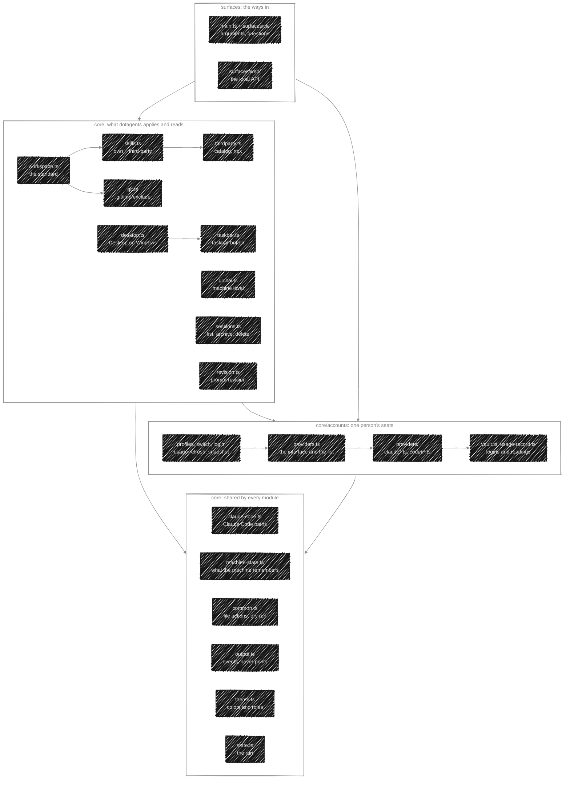

# Architecture and development

## Repository layout

```
dotagents-core/
├── skills/                    the skills dotagents itself uses: session-archive (its parser serves `sessions`), move-sessions
├── standards/                 the .agents/ and .artifacts/ standards
├── templates/workspace/       AGENTS.md and INDEX.md for new workspaces
├── templates/config/          a generic configuration: the tests and the CI run against it, and it is where a new one starts
├── assets/                    the logo, the avatars and the README's pictures
├── docs/                      this documentation
├── cli.ts                     the dotagents command: turns on Node's compile cache, then loads main.ts
├── main.ts                    reads the arguments, picks the command, prints the help
├── core/                      the data and the actions, drawing nothing (see below)
│   └── accounts/              the accounts: profiles, switch, login, usage; one file per provider in providers/
├── surfaces/                  the ways in, each using core/ only
│   ├── cli/                   one file per command: its help, its questions, its run
│   └── web/                   server.ts: the local API of dotagents start (127.0.0.1, token, live events, apiVersion)
├── test/                      unit tests (node:test)
├── .github/workflows/         CI: skill validation and command tests on three systems
└── package.json
```

The configuration (global instructions, rules, settings, own skills, profile icons) is not here: it lives in its own repository, `dotagents-config`, next to the clone ([Global configuration](global-configuration.md)).

## Modules

The command is TypeScript run directly by Node (type stripping, no build step) with one dependency: `@clack/prompts`, for the questions and the spinners. The colors come from `core/theme.ts`. `main.ts`, loaded by `cli.ts` once Node's compile cache is on, reads the arguments and hands them to one of the commands in `surfaces/cli/`, which asks the questions and calls the modules. Everything that decides what a workspace or a machine should look like lives in `core/`, in a few modules with small interfaces.

**Core and surfaces.** `core/` holds the data and the actions and draws nothing. A surface is a way in: the commands (`surfaces/cli/`) and the local API (`surfaces/web/`, which the dotagents sidebar reads over HTTP; the panel, the avatars and everything else drawn live there). Nothing here draws a page. Each surface uses `core/` and never another surface; `main.ts`, at the root, is the one place that picks one, and where `start` joins the command line to the web server. `test/boundaries.test.ts` fails when an import breaks the rule.

The arrows point to what a part uses, and none runs in a circle (`test/boundaries.test.ts`). The accounts go one way: surfaces, then the coordination, then `providers.ts`, then each provider's files, then the storage they share. The table below gives each module's interface.



| Module | Interface | Behind it |
|---|---|---|
| `core/workspace.ts` | `applyWorkspace(repo, ws, skills)`, `verifyWorkspace(repo, ws)`, `wrapRepository(dir)`, `listRepoInAgentsMd`, `assertWorkspace`, `childRepos`, `workspaceName` | The standard as one ordered list of items, each with how to apply it and how to verify it, side by side. `init`, `new` and `update --all` apply the list; `check` verifies it. |
| `core/skills.ts` | `listSkills(repo)`, `resolveSkills(repo, names)`, `skillsIn(repo, ws)`, `applySkills(ws, skills, { installer })`, `verifySkills(repo, ws)` | Own skills and third-party ones as one list (`name`, `kind`, `source`, `description`). Linking, installing (and in which order), and the skill checks. |
| `core/thirdparty.ts` | `loadCatalog`, `saveCatalog`, `discoverSkills`, `parseSkill`, `npxInstaller` | The catalog file, reading `SKILL.md`, and the installer adapter that runs `npx skills add`. |
| `core/git.ts` | `ensureExcluded`, `removeExcluded`, `gitRepoOf`, `isRepoRoot`, `trackedAgentFiles`, `untrackedAgentFiles` | Keeping agent files out of a project's git through `.git/info/exclude`. |
| `core/memory.ts` | `applyMemory(ws, configDirs)`, `verifyMemory(ws, configDirs)`, `projectSlug(dir)` | Workspace memory: `autoMemoryDirectory` in the workspace's `.claude/settings.local.json` pointing at `.artifacts/memory/`, the copy of each profile's earlier memory of the workspace, and its checklist. |
| `core/global.ts` | `installGlobal(repo, configDir?)`, `renderInstructions(repo)` | The machine level: instructions, rules and settings, applied to one Claude Code config folder (`~/.claude` by default). |
| `core/claude-code.ts` | `defaultConfigDir`, `userFiles(configDir)`, `projectFiles(ws)`, `sessionActivity(configDir)` | Where Claude Code reads its configuration, at the user level and in a workspace, and its running sessions (`sessions/<pid>.json`, working or waiting, counted while the process runs). No other module spells these paths out. |
| `core/desktop.ts` | `applyDesktop`, `removeDesktop`, `verifyDesktop`, `openDesktop`, `powershellShortcuts` | A Desktop app per profile on Windows, Claude Desktop or the ChatGPT app (`CLAUDE_DESKTOP`, `CHATGPT_DESKTOP`, named by each provider): data folder, `.vbs` launcher and Start menu shortcut. Shortcuts go through an adapter: PowerShell for real, a fake one in the tests. |
| `core/taskbar.ts` | `taskbarWatcher`, `appIdFor`, `SHORTCUT_APP_ID_CS` | One taskbar button per profile: the PowerShell watcher (with its C#) that tags an instance's windows with the profile's AppUserModelID, icon and name, and the C# that writes that ID into a shortcut. |
| `core/peer.ts` | `applyPeer(find)`, `findPeer`, `peerUp`, `runOnPeer`, `peerToolCheck` | Finds the other side of the machine (Windows from WSL, WSL from Windows) once, at install, and records it. Finding it runs a command there, so it goes through an adapter; the tests pass a fake one. |
| `core/sessions.ts` | `listSessions({ dirs, under })`, `configDirs()`, `fromPeer(path, peer)`, `archiveRoot(dir)`, `archiveSession(session, labels)`, `deleteSession(session)`, `accountLabels()` | Claude Code's sessions in every config folder, this side's and the other side's: a quick summary of each transcript (title, accounts, last activity), the workspace its archive goes to, whether it still runs, the archive written with the `session-archive` skill's parser (imported, so the two write the same file), and the deletion of everything Claude Code keeps for a session. |
| `core/revision.ts` | `runHook`, `revise`, `reviseSession`, `enable`, `disable`, `isEnabled`, `readBackend`, `saveBackend` | Prompt revision (ADR 0006): the opt-in `UserPromptSubmit` hook that proofreads each message with Sonnet, through the signed-in account or an API key, and its log. |
| `core/accounts/providers.ts` | `providers()`, `providerFor(profile)`, `providerById`, `activeProfiles`, `installProviders`, `verifyProviderConfigs`, the `Provider` type | The one shape of what differs between Claude and ChatGPT (slot, vault, sign-in, usage, checks), and the list of providers: a provider left out of it is off everywhere. Nothing outside `core/accounts/` imports a provider's own files, and nothing outside `providers/` branches on which provider a profile has; `test/boundaries.test.ts` checks both. |
| `core/accounts/provider-labels.ts` | `LABELS` | What each provider is called in messages. A leaf: it imports no adapter. |
| `core/accounts/profiles.ts` | `setUpProfile`, `dropProfile`, `installProfiles`, `verifyProfiles`, `verifyLogins`, `launcherDir` | The profiles of the machine, one per account the person holds, all sharing one config folder per side: the configuration applied there and each Claude profile's Desktop app on Windows. |
| `core/accounts/switch.ts` | `switchProfile({ name, save, here, peer })`, `switchHere`, `saveToVault`, `putInSlot`, `peerSwitch` | The switch in place (ADR 0004), the same order for every provider, under the login lock: save the slot's login back to its vault, write the chosen one, check it, and the same switch on the other side through an adapter. |
| `core/accounts/login.ts` | `loginProfile({ name, all })` | `login`: the sign-in each provider runs its own way (Claude through the slot, Codex in a temporary folder), then the check that the account is the profile's and the new login kept in its vault. |
| `core/accounts/vault.ts` | `vaultDir`, `withLoginLock(fn)`, `writePrivate` | Where each profile's saved login waits (`<state>/vault/<profile>/`, readable only by the user), and the lock and whole-file writes every change to a login takes. |
| `core/accounts/usage-refresh.ts` | `refreshUsage({ force })`, `fetchUsage(profile)` | Asking each provider for its profiles' usage the same way: the pacing between asks, the backoff after a failure, the record kept and the report. |
| `core/accounts/usage-record.ts` | `readRecord`, `writeRecord`, `BACKOFF_MS` | The last usage reading per profile, `<state>/usage/<profile>.json`, each provider's in its own shape. |
| `core/accounts/usage.ts` | `profileUsage(profile, now)`, `normalize(cache, now)`, `pace(window, now)`, `thresholdAlerts(list, levels)`, `avatarState`, `usageLines`, `shortLines` | The usage of a profile normalized into windows (session, week, per-model week), with the pace, the 70% and 90% notices, the states (not signed in, no data, stale) and the lines the views print. Takes "now" as an argument, so the tests fix it. |
| `core/accounts/snapshot.ts` | `readAll(now)`, `usageJson(list, now)`, `startAnswer`, `watchPeer` | The usage of every profile for every surface: each provider reads its own, in the providers' order, and this module puts them together with the current account of each side. The versioned JSON of `usage --json` and the `start` API. |
| `core/accounts/spend.ts` | `spendReport`, `readSpend`, `recordHistory`, `readHistory` | `usage --spend`: the history of each window's %, the tokens in Claude Code's transcripts on both sides, and what 1% costs. |
| `core/accounts/prices.ts` | `costOf(model, tokens)` | The API's prices, in one place, for the spend and the prompt revision. |
| `core/accounts/providers/claude.ts` | `claude` (default export, a `Provider`), `claudeLogin` | Claude's steps: the slot (`~/.claude`, `~/.claude.json`'s `oauthAccount`), its vault, the sign-in through the slot, its checks. |
| `core/accounts/providers/claude-store.ts` | `slotLogin`, `vaultLogin`, `knownLogin`, `slotProfile`, `liveLogin`, `profileAccount`, `loginMark` | Where a Claude profile's login is and whose it is. |
| `core/accounts/providers/claude-usage.ts` | `askClaude`, `liveUsage(name)`, `httpFetcher` | Live usage (ADR 0003): Anthropic's OAuth usage endpoint with the profile's login, renewed only near expiry and written back under the login lock. The network is an adapter; the tests pass a fake one. |
| `core/accounts/providers/claude-snapshot.ts` | `readClaudeUsage`, `readClaudeSlots` | Claude's part of the snapshot: Claude Code's caches and the live records, the newer winning, and the other side's caches when `machine.json` knows it. |
| `core/accounts/providers/codex.ts` | `codex` (default export, a `Provider`), `codexSignIn`, `restartDaemon`, `verifyCodexLogins` | ChatGPT's steps (ADR 0007): the slot `<CODEX_HOME>/auth.json` under Codex's lock, the sign-in in a temporary folder, the daemon restart, its checks. |
| `core/accounts/providers/codex-store.ts` | `slotLogin`, `vaultLogin`, `codexSlotProfile`, `codexAccount`, `codexLoginMark` | Where a ChatGPT profile's login is and whose it is. |
| `core/accounts/providers/codex-usage.ts` | `askCodex`, `askRateLimits`, `normalizeRateLimits`, `codexLiveUsage`, `readCodexUsage`, `readCodexSlots` | Live usage of the ChatGPT profiles through `codex app-server` (`account/rateLimits/read`), in a temporary `CODEX_HOME` for the profiles outside the slot. The app-server is a `SpawnAppServer`; the tests pass a fake script. |
| `core/accounts/providers/codex-config.ts` | `installCodex`, `verifyCodexConfig`, `codexHome`, `codexOnPath` | What `install` puts in Codex's configuration: the instructions with the rules at the end. |
| `core/machine-state.ts` | `loadWorkspaces`, `registerWorkspace`, `untrackWorkspace`, `loadProfiles`, `saveProfile`, `removeProfile`, `stateDir` | What dotagents remembers about this machine, outside the repository. Every file has a format version and is checked when read: a broken file, or one from a newer dotagents, stops the command instead of being overwritten. |
| `core/log.ts` | `log`, `logChange`, `logFile`, `mask` | The logs of what runs on its own, one text file each in `<state>/logs/`, with credentials and email addresses masked ([Logs](logs.md)). |
| `core/common.ts` | file actions (`ensureDirLink`, `ensureFile`, `writeGenerated`, `ensureJsonKey`…), `runWithSpinner`, `parseArgs` | Junctions on Windows and symlinks elsewhere, backups, dry run. |
| `core/output.ts` | `report`, `checkItem`, `checkWarn`, `section`, `header`, `finish`, `setRenderer`, `displayPath` | Every result becomes an event for the current renderer: the rail in a terminal, plain lines when piped, a list in the tests. The modules never print. |
| `core/theme.ts` | `colorLevel(env, isTTY)`, `backgroundOf(env)`, `painter(level, background)`, `ROLES`, `readableOn(hex, background)`, `badge(level)` | How dotagents looks, for every surface: the color level from the environment (`NO_COLOR`, `FORCE_COLOR`, `TERM`, the terminal), the background (`DOTAGENTS_THEME`, `COLORFGBG`, dark by default), the roles in Geist's palette (one hex per background, a basic color at 16 colors), a profile color's readable variant and the badge. |
| `core/state.ts` | `state`, `resetState` | The run: `--dry-run`, the counters behind the summary and the exit code, and the folder paths are shown relative to. |

Three decisions shape the modules:

- **A rule of the standard is written once.** Adding one means adding an item to the list in `core/workspace.ts`, with its `apply` and its `verify` next to each other.
- **Output is an event stream.** A module reports what happened (`report`, `checkItem`…) and never formats it; the renderer decides how it looks. A new output (`--json`, a full-screen view) is one more renderer, not a change in the modules.
- **Third-party installation is an adapter.** `applySkills` receives an `installer`: `npxInstaller` by default, a fake one in the tests. The order that matters (link `.claude/skills` first, install after) stays inside the skills module.

Every action is idempotent: it looks at what is there, does nothing when it is already right, and reports `ok`. That is what makes `--dry-run`, repeated runs and `update --all` safe.

## Development

```bash
npm install
npm test                 # type check (tsc, strict) + unit tests (node:test)
node cli.ts --help      # run without npm link
```

**Unit tests** (`test/`) go through the modules' interfaces on real temporary folders: applying and verifying a workspace, idempotency, dry run, links versus copies, wrapping a repository, third-party skills through a fake installer (no network), git exclusion inside a real repository, the global install with a temporary home folder, and the `move-sessions` and `session-archive` scripts against a temporary Claude Code data folder. They run in a couple of seconds.

**CI** runs on every push that touches the code:

- **Validate skills:** runs [skills-ref](https://github.com/agentskills/agentskills/tree/main/skills-ref) on every skill in `skills/`.
- **Test scripts:** on Linux, Windows and macOS, it:
  - runs `npm test` and links the command;
  - runs every command end to end, including real `npx skills` installations and `new` with local repositories;
  - checks that a second run changes nothing.

**Commits** follow the commit convention: gitmoji plus Conventional Commits, one line in English, no co-author trailer.

**The brand and the README's captures:**

- `assets/dotagents.svg` is the symbol, the face `..` on a `#171717` square.
- `assets/readme/` holds the README's diagrams, each light and dark, made by `node scripts/readme/generate.mjs`.
- `assets/dotagents-core-lockup-light.svg` and `-dark.svg` are the symbol with "dotagents-core" in Geist Mono 600 (the script also writes the dotagents-config lockup, which goes to that repository), the text as outlines, since GitHub shows SVGs through ``, which loads no web fonts. To make them again, download the font and run `scripts/lockup.py` with fontTools:

  ```bash
  curl -sA "Mozilla/4.0" "https://fonts.googleapis.com/css2?family=Geist+Mono:wght@600" | grep -o 'https://[^)]*' | head -1 | xargs curl -so /tmp/geistmono600.ttf
  uvx --from fonttools python -I scripts/lockup.py /tmp/geistmono600.ttf assets
  ```

- `docs/media/` holds the captures at the top of the README, drawn by `npm run media` (`scripts/media.ts`) from the same lines `usage` prints, for sample profiles at a fixed moment. `test/media.test.ts` fails when they no longer match the views: run `npm run media` after changing the views or the theme.

**Changing a profile icon:** edit `config/assets/claude-<name>.svg`, then rebuild the `.ico` (16 to 256 px) and run `dotagents install` on Windows:

```bash
uvx --from cairosvg==2.7.1 cairosvg assets/claude-<name>.svg -o /tmp/icon.png -W 256 -H 256
uv run --no-project --with pillow==12.0.0 python -c "from PIL import Image; Image.open('/tmp/icon.png').save('assets/claude-<name>.ico', sizes=[(s, s) for s in (16, 24, 32, 48, 64, 128, 256)])"
```

**Adding a command:** write `surfaces/cli/<name>.ts` exporting a `Command` (name, usage, summary, group, `run`), add it to `COMMANDS` in `main.ts` (the order is the help's order), and describe it in [Commands](commands.md) and in the table of the README.

**Adding a rule to the workspace standard:**

1. Add an item to `STANDARD` in `core/workspace.ts` with `apply` and `verify`.
2. Add a test in `test/workspace.test.ts`.
3. Describe the rule in `standards/` and in [What init creates](workspaces.md#what-init-creates) and [What check verifies](workspaces.md#what-check-verifies).

**After changing a command,** update [commands.md](commands.md), and the summary table in the [README](../README.md#commands-at-a-glance) when the command list changes.
