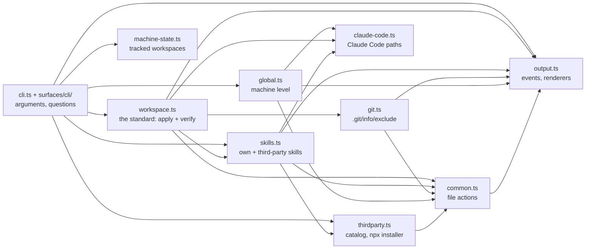

# Architecture and development

## Repository layout

```
dotagents/
├── global/
│   ├── instructions.md        global instructions ({{AGENTS_REPO}} is filled in by install)
│   └── env/                   machine notes appended per platform (win32.md, linux.md, darwin.md)
├── rules/                     global rules
├── claude/settings.json       → ~/.claude/settings.json
├── skills/                    own skills
│   └── third-party-skills.json  catalog of third-party skills
├── standards/                 the .agents/ and .artifacts/ standards
├── templates/workspace/       AGENTS.md and INDEX.md for new workspaces
├── assets/                    the profile icons: claude-<name>.svg, the source, and the .ico the Start menu shortcuts use
├── docs/                      this documentation
├── cli.ts                     the dotagents command: reads the arguments, picks the command, prints the help
├── core/                      the data and the actions, drawing nothing (see below)
├── surfaces/                  the ways in, each using core/ only
│   ├── cli/                   one file per command: its help, its questions, its run
│   └── web/                   the dashboard: server.ts (127.0.0.1, token, live events) and page/
├── test/                      unit tests (node:test)
├── .github/workflows/         CI: skill validation and command tests on three systems
└── package.json
```

## Modules

The command is TypeScript run directly by Node (type stripping, no build step) with one dependency: `@clack/prompts`, for the questions and the spinners. The colors come from `core/theme.ts`. `cli.ts` reads the arguments and hands them to one of the commands in `surfaces/cli/`, which asks the questions and calls the modules. Everything that decides what a workspace or a machine should look like lives in `core/`, in a few modules with small interfaces.

**Core and surfaces.** `core/` holds the data and the actions and draws nothing. A surface is a way in: the commands (`surfaces/cli/`) and the dashboard (`surfaces/web/`: its local server and page), later the VS Code extension, the tray and the MCP server. Each surface uses `core/` and never another surface; `cli.ts`, at the root, is the one place that picks one, and where `start` joins the command line to the web server. `test/boundaries.test.ts` fails when an import breaks the rule.



| Module | Interface | Behind it |
|---|---|---|
| `core/workspace.ts` | `applyWorkspace(repo, ws, skills)`, `verifyWorkspace(repo, ws)`, `wrapRepository(dir)`, `listRepoInAgentsMd`, `assertWorkspace`, `childRepos`, `workspaceName` | The standard as one ordered list of items, each with how to apply it and how to verify it, side by side. `init`, `new` and `update --all` apply the list; `check` verifies it. |
| `core/skills.ts` | `listSkills(repo)`, `resolveSkills(repo, names)`, `skillsIn(repo, ws)`, `applySkills(ws, skills, { installer })`, `verifySkills(repo, ws)` | Own skills and third-party ones as one list (`name`, `kind`, `source`, `description`). Linking, installing (and in which order), and the skill checks. |
| `core/thirdparty.ts` | `loadCatalog`, `saveCatalog`, `discoverSkills`, `parseSkill`, `npxInstaller` | The catalog file, reading `SKILL.md`, and the installer adapter that runs `npx skills add`. |
| `core/git.ts` | `ensureExcluded`, `removeExcluded`, `gitRepoOf`, `isRepoRoot`, `trackedAgentFiles`, `untrackedAgentFiles` | Keeping agent files out of a project's git through `.git/info/exclude`. |
| `core/global.ts` | `installGlobal(repo, configDir?)`, `renderInstructions(repo)` | The machine level: instructions, rules and settings, applied to one Claude Code config folder (`~/.claude` by default). |
| `core/claude-code.ts` | `defaultConfigDir`, `userFiles(configDir)`, `projectFiles(ws)` | Where Claude Code reads its configuration, at the user level and in a workspace. No other module spells these paths out. |
| `core/profiles.ts` | `setUpProfile`, `dropProfile`, `installProfiles`, `verifyProfiles`, `launcherFile` | The Claude profiles of the machine: a config folder each, the configuration applied to it, and a `claude-<name>` launcher. |
| `core/desktop.ts` | `applyDesktop`, `removeDesktop`, `verifyDesktop`, `powershellShortcuts` | A second Claude Desktop app per profile on Windows: data folder, `.vbs` launcher and Start menu shortcut. Shortcuts go through an adapter: PowerShell for real, a fake one in the tests. |
| `core/taskbar.ts` | `taskbarWatcher`, `appIdFor`, `SHORTCUT_APP_ID_CS` | One taskbar button per profile: the PowerShell watcher (with its C#) that tags an instance's windows with the profile's AppUserModelID, icon and name, and the C# that writes that ID into a shortcut. |
| `core/usage.ts` | `profileUsage(profile, now)`, `normalize(cache, now)`, `pace(window, now)`, `bar(pct)` | The usage of a profile, read from Claude Code's cache and normalized into windows (session, week, per-model week), with the pace and the states (not signed in, no data, stale). Takes "now" as an argument, so the tests fix it. |
| `core/memory.ts` | `applyMemory(ws, configDirs)`, `verifyMemory(ws, configDirs)`, `projectSlug(dir)` | Workspace memory: `autoMemoryDirectory` in the workspace's `.claude/settings.local.json` pointing at `.artifacts/memory/`, the copy of each profile's earlier memory of the workspace, and its checklist. |
| `core/snapshot.ts` | `readUsage(now)`, `usageJson(list, now)` | The usage of every profile for every surface: this side's caches and, when `machine.json` knows the other side of the machine, that side's caches too (paths translated, read only), the newer data of the same account winning. The versioned JSON of `usage --json`. |
| `core/peer.ts` | `applyPeer(find)`, `findPeer` | Finds the other side of the machine (Windows from WSL, WSL from Windows) once, at install, and records it. Finding it runs a command there, so it goes through an adapter; the tests pass a fake one. |
| `core/refresh.ts` | `refreshUsage(now, { ask })`, `claudeAsker` | `usage --refresh`: asks Claude Code for each profile's usage with `claude -p "/usage"`, at most once every 3 minutes per profile. The asking is an adapter; the tests pass a fake one. |
| `core/machine-state.ts` | `loadWorkspaces`, `registerWorkspace`, `untrackWorkspace`, `loadProfiles`, `saveProfile`, `removeProfile`, `stateDir` | What dotagents remembers about this machine, outside the repository. Every file has a format version and is checked when read: a broken file, or one from a newer dotagents, stops the command instead of being overwritten. |
| `core/common.ts` | file actions (`ensureDirLink`, `ensureFile`, `writeGenerated`, `ensureJsonKey`…), `runWithSpinner`, `parseArgs` | Junctions on Windows and symlinks elsewhere, backups, dry run. |
| `core/output.ts` | `report`, `checkItem`, `checkWarn`, `section`, `header`, `finish`, `setRenderer`, `displayPath` | Every result becomes an event for the current renderer: the rail in a terminal, plain lines when piped, a list in the tests. The modules never print. |
| `core/theme.ts` | `colorLevel(env, isTTY)`, `backgroundOf(env)`, `painter(level, background)`, `ROLES`, `readableOn(hex, background)`, `badge(level)` | How dotagents looks, for every surface: the color level from the environment (`NO_COLOR`, `FORCE_COLOR`, `TERM`, the terminal), the background (`DOTAGENTS_THEME`, `COLORFGBG`, dark by default), the roles in Geist's palette (one hex per background, a basic color at 16 colors), a profile color's readable variant and the badge. |
| `core/state.ts` | `state`, `resetState` | The run: `--dry-run`, the counters behind the summary and the exit code, and the folder paths are shown relative to. |

Three decisions shape the modules:

- **A rule of the standard is written once.** Adding one means adding an item to the list in `core/workspace.ts`, with its `apply` and its `verify` next to each other.
- **Output is an event stream.** A module reports what happened (`report`, `checkItem`…) and never formats it; the renderer decides how it looks. A new output (`--json`, a full-screen view) is one more renderer, not a change in the modules.
- **Third-party installation is an adapter.** `applySkills` receives an `installer`: `npxInstaller` by default, a fake one in the tests. The order that matters (link `.claude/skills` first, install after) stays inside the skills module.

Every action is idempotent: it looks at what is there, does nothing when it is already right, and reports `ok`. That is what makes `--dry-run`, repeated runs and `update --all` safe.

## Development

```bash
npm install
npm test                 # type check (tsc, strict) + unit tests (node:test)
node cli.ts --help      # run without npm link
```

**Unit tests** (`test/`) go through the modules' interfaces on real temporary folders: applying and verifying a workspace, idempotency, dry run, links versus copies, wrapping a repository, third-party skills through a fake installer (no network), git exclusion inside a real repository, the global install with a temporary home folder, and the `move-sessions` script against a temporary Claude Code data folder. They run in a couple of seconds.

**CI** runs on every push that touches the code:

- **Validate skills:** runs [skills-ref](https://github.com/agentskills/agentskills/tree/main/skills-ref) on every skill in `skills/`.
- **Test scripts:** on Linux, Windows and macOS, it:
  - runs `npm test` and links the command;
  - runs every command end to end, including real `npx skills` installations and `new` with local repositories;
  - checks that a second run changes nothing.

**Commits** follow [the commit convention](../rules/commit-conventions.md): gitmoji plus Conventional Commits, one line in English, no co-author trailer.

**The brand and the README's captures:**

- `assets/dotagents.svg` is the symbol, the face `..` on a `#171717` square.
- `assets/face/` holds one SVG per state of the face (ok, working, warn, limit, asleep, done, error), for the graphic surfaces.
- `assets/dotagents-lockup-light.svg` and `-dark.svg` are the symbol with "dotagents" in Geist Mono 600, the text as outlines, since GitHub shows SVGs through ``, which loads no web fonts. To make them again, download the font and run `scripts/lockup.py` with fontTools:

  ```bash
  curl -sA "Mozilla/4.0" "https://fonts.googleapis.com/css2?family=Geist+Mono:wght@600" | grep -o 'https://[^)]*' | head -1 | xargs curl -so /tmp/geistmono600.ttf
  uvx --from fonttools python -I scripts/lockup.py /tmp/geistmono600.ttf assets
  ```

- `docs/media/` holds the captures at the top of the README, drawn by `npm run media` (`scripts/media.ts`) from the same lines `usage` prints, for sample profiles at a fixed moment. `test/media.test.ts` fails when they no longer match the views: run `npm run media` after changing the views or the theme.

**Changing a profile icon:** edit `assets/claude-<name>.svg`, then rebuild the `.ico` (16 to 256 px) and run `dotagents install` on Windows:

```bash
uvx --from cairosvg==2.7.1 cairosvg assets/claude-<name>.svg -o /tmp/icon.png -W 256 -H 256
uv run --no-project --with pillow==12.0.0 python -c "from PIL import Image; Image.open('/tmp/icon.png').save('assets/claude-<name>.ico', sizes=[(s, s) for s in (16, 24, 32, 48, 64, 128, 256)])"
```

**Adding a command:** write `surfaces/cli/<name>.ts` exporting a `Command` (name, usage, summary, group, `run`), add it to `COMMANDS` in `cli.ts` (the order is the help's order), and describe it in [Commands](commands.md) and in the table of the README.

**Adding a rule to the workspace standard:**

1. Add an item to `STANDARD` in `core/workspace.ts` with `apply` and `verify`.
2. Add a test in `test/workspace.test.ts`.
3. Describe the rule in `standards/` and in [What init creates](workspaces.md#what-init-creates) and [What check verifies](workspaces.md#what-check-verifies).

**After changing a command,** update [commands.md](commands.md), and the summary table in the [README](../README.md#commands-at-a-glance) when the command list changes.
