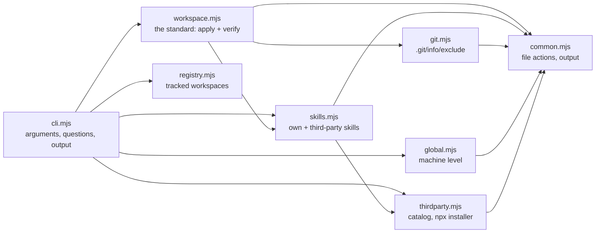

# Architecture and development

## Repository layout

```
dotagents/
├── global/
│   ├── instructions.md        global instructions ({{AGENTS_REPO}} is filled in by install)
│   └── env/                   machine notes appended per platform (win32.md, linux.md, darwin.md)
├── rules/                     global rules
├── claude/settings.json       → ~/.claude/settings.json
├── skills/                    own skills
│   └── third-party-skills.json  catalog of third-party skills
├── standards/                 the .agents/ and .artifacts/ standards
├── templates/workspace/       AGENTS.md and INDEX.md for new workspaces
├── docs/                      this documentation
├── cli.mjs                    the dotagents command: arguments, questions, output
├── lib/                       the modules (see below)
├── test/                      unit tests (node:test)
├── .github/workflows/         CI: skill validation and command tests on three systems
└── package.json
```

## Modules

The command is plain Node (ES modules) with two dependencies. `cli.mjs` reads the arguments, asks the questions and prints. Everything that decides what a workspace or a machine should look like lives in `lib/`, in a few modules with small interfaces:



| Module | Interface | Behind it |
|---|---|---|
| `lib/workspace.mjs` | `applyWorkspace(repo, ws, skills)`, `verifyWorkspace(repo, ws)`, `wrapRepository(dir)`, `listRepoInAgentsMd`, `assertWorkspace`, `childRepos`, `workspaceName` | The standard as one ordered list of items, each with how to apply it and how to verify it, side by side. `init`, `new` and `update --all` apply the list; `check` verifies it. |
| `lib/skills.mjs` | `listSkills(repo)`, `resolveSkills(repo, names)`, `skillsIn(repo, ws)`, `applySkills(ws, skills, { installer })`, `verifySkills(repo, ws)` | Own skills and third-party ones as one list (`name`, `kind`, `source`, `description`). Linking, installing (and in which order), and the skill checks. |
| `lib/thirdparty.mjs` | `loadCatalog`, `saveCatalog`, `discoverSkills`, `parseSkill`, `npxInstaller` | The catalog file, reading `SKILL.md`, and the installer adapter that runs `npx skills add`. |
| `lib/git.mjs` | `ensureExcluded`, `removeExcluded`, `gitRepoOf`, `isRepoRoot`, `trackedAgentFiles`, `untrackedAgentFiles` | Keeping agent files out of a project's git through `.git/info/exclude`. |
| `lib/global.mjs` | `installGlobal(repo)`, `renderInstructions(repo)` | The machine level: instructions, rules and settings. |
| `lib/registry.mjs` | `loadWorkspaces`, `registerWorkspace`, `untrackWorkspace` | The tracked workspaces of this machine. |
| `lib/common.mjs` | file actions (`ensureDirLink`, `ensureFile`, `writeGenerated`, `ensureJsonKey`…), output (`report`, `checkItem`, `section`, `finish`…), `runWithSpinner`, `parseArgs` | Junctions on Windows and symlinks elsewhere, backups, dry run, the terminal and plain output. |

Two decisions shape the modules:

- **A rule of the standard is written once.** Adding one means adding an item to the list in `lib/workspace.mjs`, with its `apply` and its `verify` next to each other.
- **Third-party installation is an adapter.** `applySkills` receives an `installer`: `npxInstaller` by default, a fake one in the tests. The order that matters (link `.claude/skills` first, install after) stays inside the skills module.

Every action is idempotent: it looks at what is there, does nothing when it is already right, and reports `ok`. That is what makes `--dry-run`, repeated runs and `update --all` safe.

## Development

```bash
npm install
npm test                 # unit tests (node:test)
node cli.mjs --help      # run without npm link
```

**Unit tests** (`test/`) go through the modules' interfaces on real temporary folders: applying and verifying a workspace, idempotency, dry run, links versus copies, wrapping a repository, third-party skills through a fake installer (no network), git exclusion inside a real repository, the global install with a temporary home folder, and the `move-sessions` script against a temporary Claude Code data folder. They run in a couple of seconds.

**CI** runs on every push that touches the code:

- **Validate skills:** runs [skills-ref](https://github.com/agentskills/agentskills/tree/main/skills-ref) on every skill in `skills/`.
- **Test scripts:** on Linux, Windows and macOS, it:
  - runs `npm test` and links the command;
  - runs every command end to end, including real `npx skills` installations and `new` with local repositories;
  - checks that a second run changes nothing.

**Commits** follow [the commit convention](../rules/commit-conventions.md): gitmoji plus Conventional Commits, one line in English, no co-author trailer.

**Adding a rule to the workspace standard:**

1. Add an item to `STANDARD` in `lib/workspace.mjs` with `apply` and `verify`.
2. Add a test in `test/workspace.test.mjs`.
3. Describe the rule in `standards/` and in [What init creates](workspaces.md#what-init-creates) and [What check verifies](workspaces.md#what-check-verifies).

**After changing a command,** update [commands.md](commands.md), and the summary table in the [README](../README.md#commands-at-a-glance) when the command list changes.
