# Global configuration

`dotagents install` writes:

| From | To | How |
|---|---|---|
| `global/instructions.md` + `global/env/<platform>.md` | `~/.claude/CLAUDE.md` | generated file |
| `rules/` | `~/.claude/rules` | folder link |
| `claude/settings.json` | `~/.claude/settings.json` | link on Linux and macOS, copy on Windows |
| `claude/global-config.json` | `~/.claude.json` | only its keys, the rest of the file kept |

- **`global/instructions.md`** holds the global instructions: language, commit convention, how workspaces work. It has no machine paths. `{{AGENTS_REPO}}` becomes the clone's location, and the file for the current platform (`env/win32.md`, `env/linux.md`, `env/darwin.md`) is appended when it exists. That is where machine notes go, such as the shell, where projects live or which tools are installed.
- **`rules/`** holds rules for every project. Claude Code reads them through `~/.claude/rules`. Today there are two: [the commit convention](../rules/commit-conventions.md) and [simplicity](../rules/simplicity.md).
- **Settings:** Claude Code's settings file, shared by every profile, since they all use `~/.claude`. Most `/config` options are saved there. On Linux and macOS it links to the repository's file, so a change shows up in `git diff` (and `profile list` warns until it's committed). On Windows it is a copy: `install` updates a copy that only fell behind the repository, but keeps one that `/config` changed and says so; `dotagents settings pull` brings that change into the repository, and `install` on the other machines takes it there.
- **`claude/global-config.json`:** the few `/config` options Claude Code keeps in `.claude.json` instead of `settings.json` (`copyOnSelect`, `copyFullResponse`, `autoConnectIde`, `autoInstallIdeExtension`, `diffTool`, `defaultToAgentsView`, `externalEditorContext`, `leftArrowOpensAgents`, `prStatusFooterEnabled`, `claudeInChromeDefaultEnabled`). `install` sets them in `~/.claude.json` and leaves the rest of the file (the sign-in, per-project state) alone; other keys are refused. Before Claude Code has run once, the file is skipped. `profile list` warns when a value differs, and the next `install` puts the repository's back.

On Windows, a settings change made with `/config` goes back to the repository like this:

```mermaid
%%{init: {"look": "handDrawn", "handDrawnSeed": 3, "theme": "base", "themeVariables": {"fontFamily": "Geist Mono, ui-monospace, SFMono-Regular, Menlo, Consolas, monospace", "fontSize": "14px", "primaryColor": "#171717", "primaryTextColor": "#ededed", "primaryBorderColor": "#171717", "lineColor": "#8f8f8f", "textColor": "#171717", "edgeLabelBackground": "#ededed", "clusterBkg": "transparent", "clusterBorder": "#8f8f8f", "titleColor": "#808080"}}}%%
flowchart LR
    config["/config on Windows"] --> copy["~/.claude/settings.json<br/>now differs"]
    copy -- "dotagents settings pull" --> repo["claude/settings.json<br/>in your clone"]
    repo -- "commit, then dotagents install" --> others["the other machines' copy"]:::result
    classDef result fill:#ffffff,stroke:#171717,stroke-width:1.5px,color:#171717
```

A file already in place that dotagents didn't generate is kept next to the new one as `<file>.bak-<date>`.
