# Global configuration

The configuration is a folder of its own: the global instructions, the rules, the settings, your skills and each profile's Desktop icon. dotagents looks for it, in order, in the folder `DOTAGENTS_CONFIG` names, in `config/` inside the clone (a fork that keeps it there), and in `dotagents-config` next to the clone, as the install lays them out (`dotagents/dotagents-core` and `dotagents/dotagents-config`). These docs call it `config/` wherever it is. [`templates/config/`](../templates/config/) is a generic one to start from; the tests and the CI use it.

`dotagents install` writes (paths inside `config/`):

| From | To | How |
|---|---|---|
| `global/instructions.md` + `global/env/<platform>.md` | `~/.claude/CLAUDE.md` | generated file |
| `rules/` | `~/.claude/rules` | folder link |
| `claude/settings.json` | `~/.claude/settings.json` | copy, keeping the machine's own keys |
| `claude/mcp-servers.json` | `mcpServers` in `~/.claude.json`, and `[mcp_servers]` in Codex's `config.toml` | the servers named for this system |
| `claude/global-config.json` | `~/.claude.json` | only its keys, the rest of the file kept |
| the instructions above, then every file of `rules/` | `~/.codex/AGENTS.md` | generated file, only where Codex is installed |

- **`global/instructions.md`** holds the global instructions: language, commit convention, how workspaces work. It has no machine paths. `{{AGENTS_REPO}}` becomes the clone's location and `{{AGENTS_CONFIG}}` the configuration's, and the file for the current platform (`env/win32.md`, `env/linux.md`, `env/darwin.md`) is appended when it exists. That is where machine notes go, such as the shell, where projects live or which tools are installed.
- **`rules/`** holds rules for every project. Claude Code reads them through `~/.claude/rules`. The example has one, about commits.
- **Codex:** `install` also configures Codex, on a side only when Codex is installed there (a `codex` command on the PATH, or the `~/.codex` folder, or the folder `CODEX_HOME` names). Codex reads one global instructions file, `AGENTS.md` in its home folder, and has no rules folder, so the generated file is the instructions followed by every file of `rules/` under a `# Rules` heading. An `AGENTS.md` an earlier dotagents generated is replaced; one you wrote is backed up first (`AGENTS.md.bak-<time>`). The skills reach Codex as they reach Claude Code, per workspace: Codex reads `.agents/skills` in the repository and in the folders above it, where the workspace standard links them, so `install` links nothing in `~/.agents/skills`. `config.toml` is left alone: Codex writes to it itself (the trusted projects). Each side writes its own `AGENTS.md` when `install` runs there, as with Claude Code's folder: this side never writes the other's. Codex reads `AGENTS.override.md` instead of `AGENTS.md` when the first has text, so dotagents never writes it and `profile list` warns when it exists. Sources: [AGENTS.md in the Codex docs](https://learn.chatgpt.com/docs/agent-configuration/agents-md) and [skills](https://learn.chatgpt.com/docs/build-skills).
- **Settings:** Claude Code's settings file, shared by every profile, since they all use `~/.claude`. Most `/config` options are saved there. Only what holds in every project goes in it; a project's settings go in its workspace's `.claude/settings.json` or `.claude/settings.local.json` ([where a setting goes](../standards/agents.md)). It is a copy on every system (an older install left a link on Linux and macOS; the next `install` turns it into a copy): `install` updates a copy that only fell behind the repository, but keeps one that `/config` changed and says so; `dotagents settings pull` brings that change into the repository, and `install` on the other machines takes it there. Four keys that Claude Code writes by itself belong to the machine, not to the configuration: `model` (`/model`), `modelSettings` and `effortLevel` (`/effort`) and `autoMode` (`/auto-mode-setup`, which drafts it from whichever project is open). A change in them is not a change: `install` keeps the copy's, `settings pull` doesn't take them, and a new machine starts from the repository's.
- **`claude/global-config.json`:** the few `/config` options Claude Code keeps in `.claude.json` instead of `settings.json` (`copyOnSelect`, `copyFullResponse`, `autoConnectIde`, `autoInstallIdeExtension`, `diffTool`, `defaultToAgentsView`, `externalEditorContext`, `leftArrowOpensAgents`, `prStatusFooterEnabled`, `claudeInChromeDefaultEnabled`). `install` sets them in `~/.claude.json` and leaves the rest of the file (the sign-in, per-project state) alone; other keys are refused. Before Claude Code has run once, the file is skipped. `profile list` warns when a value differs, and the next `install` puts the repository's back.

- **`claude/mcp-servers.json`:** the MCP servers every profile gets, with user scope, as `claude mcp add --scope user` would add them. For each server it names how to run it on each system: `wsl`, `win32`, `linux` or `darwin` (a server that drives something on Windows runs from WSL through `cmd.exe /c`, and on Windows through `cmd /c`). `install` writes this system's ones into `mcpServers` in `~/.claude.json` and leaves the servers it doesn't name alone; a server with no entry for this system isn't added here. Before Claude Code has run once, the file is skipped. Where Codex is installed, `install` gives it the same command (stdio) servers through `codex mcp add`, which writes them in `[mcp_servers]` of `~/.codex/config.toml` and leaves the rest of that file alone (dotagents never edits it itself); a server Codex already has the same way is left as it is, and `profile list` fails when one is missing or differs. A remote server (`url`) is left for you to add to Codex (`codex mcp add <name> --url <url>`): it may carry headers or a transport Codex doesn't take, and adding it may start a sign-in in the browser. Where `codex` doesn't run without a shell (on Windows, one installed with npm is a `.cmd`), `install` says so and adds nothing. `install --dry-run` doesn't run `codex`, which writes in its folder even to list.

  ```json
  {
    "chrome-devtools": {
      "wsl": { "command": "cmd.exe", "args": ["/c", "npx", "-y", "chrome-devtools-mcp@latest", "--autoConnect"] },
      "win32": { "command": "cmd", "args": ["/c", "npx", "-y", "chrome-devtools-mcp@latest", "--autoConnect"] }
    }
  }
  ```

A settings change made with `/config` goes back to the repository like this:

```mermaid
%%{init: {"look": "handDrawn", "handDrawnSeed": 3, "theme": "base", "themeVariables": {"fontFamily": "Geist Mono, ui-monospace, SFMono-Regular, Menlo, Consolas, monospace", "fontSize": "14px", "primaryColor": "#171717", "primaryTextColor": "#ededed", "primaryBorderColor": "#171717", "lineColor": "#8f8f8f", "textColor": "#171717", "edgeLabelBackground": "#ededed", "clusterBkg": "transparent", "clusterBorder": "#8f8f8f", "titleColor": "#808080"}}}%%
flowchart LR
    config["/config"] --> copy["~/.claude/settings.json<br/>now differs"]
    copy -- "dotagents settings pull" --> repo["config/claude/settings.json<br/>in your clone"]
    repo -- "commit, then dotagents install" --> others["the other machines' copy"]:::result
    classDef result fill:#ffffff,stroke:#171717,stroke-width:1.5px,color:#171717
```



A file already in place that dotagents didn't generate is kept next to the new one as `<file>.bak-<date>`.
